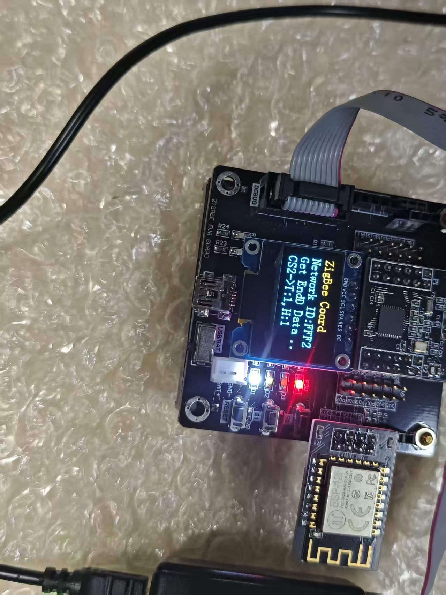
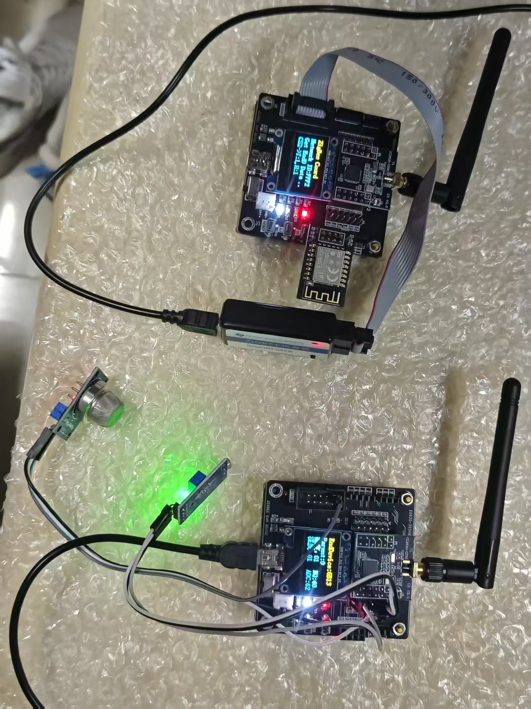
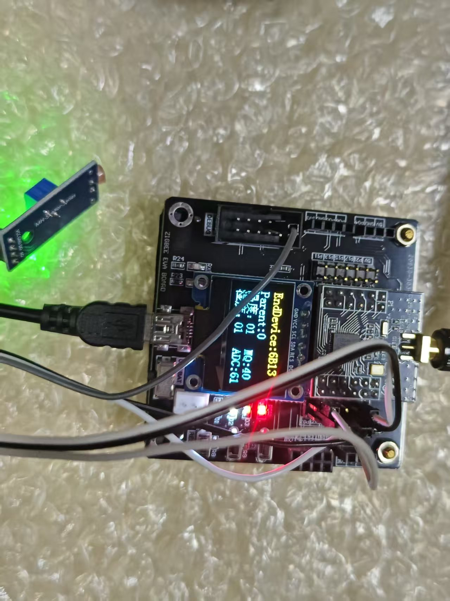

# 基于 ZigBee + MQTT 的火情监控系统

> 课程设计展示页 · CC2530 + Z-Stack + ESP-12F + OneNET

多节点环境采集（温湿度 / 烟雾 / 光照）→ ZigBee 自组网上报 → 协调器汇聚 → WiFi 模块以 MQTT 推送到 OneNET → 云端远程下发控制命令。

## 系统架构
<table>
  <thead>
    <tr>
      <th>终端节点 ×3</th><th></th>
      <th>协调器</th><th></th>
      <th>ESP-12F / WiFi</th><th></th>
      <th>云平台</th>
    </tr>
  </thead>
  <tbody>
    <tr>
      <td>DHT11 温湿度 MQ-2 烟雾 ADC 光敏 光照 ADC</td>
      <td align="center">ZigBee 单播上报 ➡ ⬅ 控制命令</td>
      <td>数据汇聚 LCD 显示 命令广播</td>
      <td align="center">UART 115200 ➡⬅</td>
      <td>AT 指令状态机 MQTT 发布/订阅</td>
      <td align="center">MQTT ➡⬅</td>
      <td>OneNET 属性 / 命令</td>
    </tr>
  </tbody>
</table>
- **上行**：终端把 `id + 温度 + 湿度 + 烟雾浓度 + 光照 + 预留位` 打包，单播到协调器 `0x0000`；协调器按设备 `id` 拆成 4 个云端属性 `cstx_temp` / `cstx_humi` / `cstx_mq2` / `cstx_lux` 发布。
- **下行**：云端命令经 MQTT 回包进入协调器，再通过 ZigBee 广播给终端，控制两路灯（`A1/A0`、`B1/B0`）。

## 主要功能

- 3 个终端节点周期采集（基础周期 4 s，叠加随机偏移避免同时发包碰撞）；
- 协调器 LCD 实时显示节点数据，累计 3000 包后软复位，防止长期运行卡死；
- 上电自动复位 WiFi 模块，串口 AT 指令完成 联网 → MQTT 配置 → 连接 → 订阅 全流程；
- 云端远程控制终端 LED，形成“感知—上报—控制”闭环。

## 代码结构

| 文件 | 职责 |
|---|---|
| `coordinator.c` | 协调器：数据汇聚、LCD 显示、AT 指令上云、命令广播、看门狗软复位 |
| `enddevice.c` | 终端：DHT11 采集、MQ-2/光敏 ADC 采集、打包单播、接收控制命令 |
| `IOT.c / IOT.h` | ESP-12F 的 AT 指令状态机与 MQTT 交互  |
| `DHT11.C / DHT11.H` | 单总线温湿度驱动（40 bit 读取 + 累加校验） |
| `delay.c / delay.h` | 微秒/毫秒延时 |
| `GenericApp.h` | 端点、Profile、簇、事件位与发送周期定义 |
| `OSAL_GenericApp.c` | OSAL 任务注册 |

> `router.c` 为基于示例改出的路由版本，保留了采集与发送逻辑，未编入最终固件。

## 技术要点

1. **OSAL 事件驱动**：应用作为独立任务挂在协议栈事件轮询上，定时事件 `GENERICAPP_SEND_MSG_EVT` 驱动采集发送，`SYS_EVENT_MSG` 处理 AF/ZDO/按键消息。
2. **AT 指令状态机**：用 `IOT_Status` 的 0→7 状态推进 `AT` → `CWMODE` → `CIPMODE` → `CWJAP` → `MQTTUSERCFG` → `MQTTCONN` → `MQTTSUB`，每步根据模块回包匹配 `OK` / `MQTTCONNECTED` 再进入下一步。
3. **随机偏移防碰撞**：发送周期为 `4000 + (rand() & 0xFF) × N` 毫秒，降低多个终端同时上报造成的空口冲突。
4. **ADC 百分比换算**：14 位 ADC（最大 8192）线性映射到 1–99，便于云端直接展示烟雾浓度与光照强度。
5. **健壮性**：WiFi 模块上电硬复位（P0.6）、接收计数达到阈值自动软复位，保证长时间无人值守运行。

## 演示

| 实物 | 接线/模块 | 运行效果 |
|---|---|---|
|  |  |  |

## 个人贡献

本项目为团队课程设计：

- **本人负责**：应用层代码实现——ZigBee 终端节点的传感器采集与上报、协调器的数据汇聚与显示、ESP-12F 的 AT 指令/MQTT 上云逻辑，以及整机联调；
- **硬件平台**：课程提供的 CC2530 开发套件与传感器模块。

## 如何编译运行

本仓库只公开**应用层源码**（`源码/Source/`），协议栈库、IAR 工程文件与课设报告不在公开范围内。

1. 准备 IAR Embedded Workbench for 8051（EW8051）8.10+ 与 Z-Stack Home 1.2.2a / 3.0；
2. 将 `源码/Source/` 放回 Z-Stack 的 `Projects/zstack/Samples/GenericApp/Source/`；
3. 在 `IOT.h` 中填写自己的 WiFi 名称/密码与 OneNET 产品、设备、Token；
4. 用 `CoordinatorEB` 配置编译协调器、`EndDeviceEB` 编译终端。

## 说明

- 源码基于 TI Z-Stack 的 `GenericApp` 示例修改，GBK 编码；
- 烟雾/光照数值为相对百分比，未做严格标定，仅用于课程演示。
